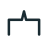
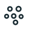
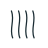
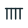
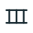
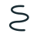
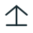
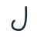

# CaveScript32 Sign Drawings · 1.0

**The 32 signs of CaveScript32 as individual vector drawings (SVG), one file per sign.**

**CaveScript32 — conceived and created by Michael S. Moniz, developed with Claude and ChatGPT.**

While researching prehistory and the origins of language to better understand large
language models, Michael S. Moniz came across the 32 geometric signs that recur across
Ice Age cave art. CaveScript32 grew from wanting to make something modern out of
something ancient and mysterious.

This set is the visual half of CaveScript32. The reference codec, mapping keys and tests
live at [github.com/mikesupo/cavescript32](https://github.com/mikesupo/cavescript32)
(archived as [10.5281/zenodo.23875861](https://doi.org/10.5281/zenodo.23875861)). The
codec reads and writes sign IDs such as `S07+S19`; this set shows what each ID looks like.

If you use these drawings, Michael would enjoy seeing your project:
[mike@suposystem.ai](mailto:mike@suposystem.ai). That invitation is optional and adds no
license condition.

## The signs

| | | | |
|:-:|:-:|:-:|:-:|
|  **S00** Asterisk |  **S01** Aviform |  **S02** Circle |  **S03** Claviform |
|  **S04** Cordiform |  **S05** Crosshatch |  **S06** Cruciform |  **S07** Cupule |
|  **S08** Dot |  **S09** Finger Fluting |  **S10** Flabelliform |  **S11** Half-Circle |
|  **S12** Line |  **S13** Negative Hand |  **S14** Open-Angle |  **S15** Oval |
|  **S16** Pectiform |  **S17** Penniform |  **S18** Positive Hand |  **S19** Quadrangle |
|  **S20** Reniform |  **S21** Scalariform |  **S22** Segmented Cruciform |  **S23** Serpentiform |
|  **S24** Spanish Tectiform |  **S25** Spiral |  **S26** Tectiform |  **S27** Triangle |
|  **S28** Unciform |  **S29** W-Sign |  **S30** Y-Sign |  **S31** Zigzag |

## Using the drawings

- Each file `signs/Snn.svg` is named by the same ID the codec uses, so a pair such as
  `S07+S19` is drawn as `signs/S07.svg` followed by `signs/S19.svg`: left sign, then
  right sign, one cell.
- Every file shares one 48 × 48 frame (`viewBox="0 0 48 48"`, units in PDF points),
  centred on the sign, so cells line up without per-sign adjustment. No sign extends more
  than 21 units from the centre, stroke included.
- Ink colour is `#192b32`, as printed. Strokes are 2.52 units wide with round caps and
  joins. To recolour, replace the colour value in the file.
- [`signs.json`](signs.json) lists each sign's ID, number, name, file and SHA-256, so
  software can check that the set is complete and unaltered.
- What each pair means depends on the key profile (v1, v2.0-draft.1, v2.0-rc.1), which
  the codec repository defines. The original v1 reading key is also printed on pages 2–3
  of the source PDF included here.

## Provenance

- **Sign categories.** The 32 categories and their names follow the catalogue of
  recurring geometric signs in European Upper Paleolithic cave art documented by
  palaeoanthropologist Genevieve von Petzinger (*The First Signs*, 2016). CaveScript32 is
  an independent modern project. It is not affiliated with or endorsed by that research,
  and it assigns modern meanings; it does not claim to recover ancient ones.
- **Drawings.** The drawings are modern renderings of those categories, made for
  CaveScript32 and first published on page 1 of the *CaveScript32 – Public Reading Key*
  (PDF dated 2 October 2026, author Michael S. Moniz / SupoSystem.ai). That PDF is included
  unchanged as [`source/CaveScript32_Public_Reading_Key.pdf`](source/CaveScript32_Public_Reading_Key.pdf)
  (SHA-256 `3a56acd1dffe73424431e4613657e75d9ca1a6174f1a42cced971cc9784cb4ca`).
- **Extraction.** On 16 November 2026 the vector paths on that page were converted to
  these SVG files by [`tools/extract_signs.py`](tools/extract_signs.py), without redrawing
  or editing. Each file renders pixel-identical to its place on the source page at 8×
  zoom. The 32 names and the 98 v1 key entries printed in the PDF match the v1 key archived
  in the codec repository.
- To reproduce: `pip install pymupdf`, then
  `python3 tools/extract_signs.py source/CaveScript32_Public_Reading_Key.pdf signs/`.

## Licenses

- **CC BY 4.0:** the sign drawings (`signs/`), the source PDF and this documentation.
  Credit: *CaveScript32 sign drawings by Michael S. Moniz*, with a link to
  [suposystem.ai/cavescript](https://suposystem.ai/cavescript/) or the DOI.
- **MIT:** `tools/extract_signs.py` and `signs.json`.
- Full texts are in [`LICENSES/`](LICENSES/). See [`LICENSE`](LICENSE) for the scope
  statement. Rights not held by Michael S. Moniz, including the archaeological
  research the categories come from, are not licensed here.

## Citing

Release 1.0 is archived on Zenodo as
[10.5281/zenodo.24294062](https://doi.org/10.5281/zenodo.24294062) (this version). The
concept DOI [10.5281/zenodo.24294061](https://doi.org/10.5281/zenodo.24294061) covers all
archived versions. Citation metadata is in [`CITATION.cff`](CITATION.cff). Citation is a
courtesy, not an additional license condition.
